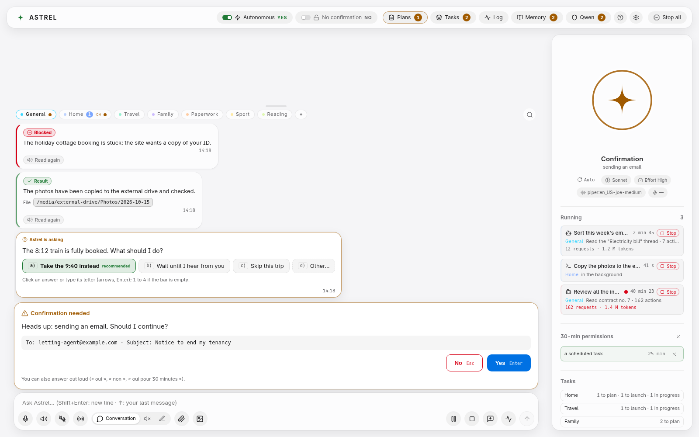
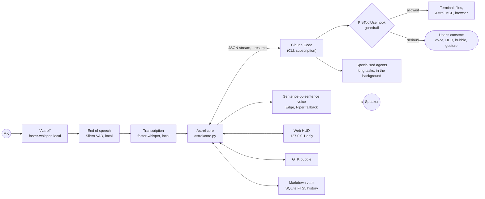

# Astrel

[Version française](README.md)

**Talk to your computer. Claude Code does the work, and asks you first before anything you can't take back.**

Astrel is a voice assistant that runs on your computer and hands the reasoning to Claude Code,
Anthropic's CLI, on the user's own subscription. You say "Astrel", you talk, it acts (terminal,
files, browser, desktop) and answers out loud. A local dashboard, the HUD, shows what it is doing
while it does it.




## What sets it apart

**A guardrail before every action.** Claude runs without the CLI's permission prompts, but a
`PreToolUse` hook (`hooks/permission_hook.py`, logic in `astrel/guard.py`) judges every tool call.
Bash commands are parsed structurally: recursive deletes, writes to sensitive files, disguised
commands. Anything serious (deleting, sending, paying, sharing, `sudo`…) waits for an answer by
voice, a click in the HUD or a gesture in front of the webcam. A hook that crashes denies. After three refusals in a row within one message, a circuit breaker
tells Claude to stop working around it and ask. Before each write by Claude, the hook keeps the
previous version: "undo what you just did" restores the last batch of files. Claude
can neither say "yes" to its own request nor loosen the guardrail: on Linux the core recognises
what comes from Claude through the process tree and the service's cgroup.

**Speech sentence by sentence.** The answer is read as it streams, one sentence as soon as it is
complete, never in the middle of a code block. Wake word and transcription run on the machine
(faster-whisper, end of speech detected by Silero VAD); only the Edge voice receives the text of
the answers, with Piper as a local fallback. The microphone is muted while Astrel speaks, and
nothing unrequested is said while the user has the floor.

**French or English.** The conversation language is set in Settings › Voice, audio and language ›
"Conversation language". In English, Whisper transcribes English, Astrel answers with an English
voice and English instructions, and voice commands have English versions. The wake word stays
"Astrel". On the same page, an assistant ("Calibrate this mic") measures background noise, then
your voice, and suggests a gain and thresholds for that microphone next to the current settings;
nothing changes until you click "Save".

**A HUD that stays on the machine.** A web page served on 127.0.0.1 only, with a token that never
appears on a command line and a signed cookie. Markdown in answers is rendered as DOM nodes from a
closed list, without `innerHTML`. A floating bubble (GTK) shows the state at a glance and receives
confirmation questions.

**Specialised agents running in the background for long tasks.** A search across several sites, a
week of email to sort: Astrel hands the slow work to sub-agents defined in `config/agents/`, each
with its role sheet, and the conversation goes on in the meantime. The HUD shows what each agent is
doing and what it has cost, and warns when one of them runs away. Large jobs go through a plan
mode: a written plan, reviewed in the HUD, then carried out.

**Memory, and tokens kept in check.** Markdown notes in a local vault, recalled before each
message; conversation history indexed with SQLite FTS5 (`history_search`). When the context goes
past 150,000 tokens, the session is handed over to a fresh one with a summary. Simple checks (a
file changed, a command answers) run without a model.

**Claude by default, other providers possible.** The brain is Claude Code on the Claude
subscription. Settings › Provider also offers Claude with an API key, then OpenAI, Gemini,
OpenRouter and Grok with an API key, through a local LiteLLM gateway (127.0.0.1, installed on
demand). Keys stay in a 0600 file and never go through the environment or the command line.
Outside Claude, Astrel chats without tools by default: tools only open after a successful test
bench, in cautious mode, and never in "No confirmation" mode or with the guardrail lifted. The Codex and
Grok Build CLIs, with those tools' own subscriptions, are wired in but refused until a real run
has shown that the guardrail holds them.

Also: per-project channels in the HUD, a per-project task list, WhatsApp restricted to the
"message yourself" chat, connectors (CalDAV calendar, Home Assistant…), image and video generation
through the browser on the user's accounts (it stops at any anti-bot challenge), and an interface
in French and English. For reliability, child processes die with the core, a message received
during a restart is picked up on the next start, and a watchdog reports a stuck loop without
stopping anything on its own.

## In numbers

Measured on this repository on 1 November 2026:

| | |
|---|---|
| Python (core `astrel/` and hooks) | 56,613 lines, comments included |
| HUD JavaScript (`hud/src/`) | 11,673 lines |
| Python tests (`tests/`) | 3,956 tests (`pytest --collect-only`), 36,347 lines |
| MCP tools exposed to Claude | 68 (59 in Astrel's server, 9 in the connectors server) |

## How it works



Everything happens on the machine except the reasoning (Claude) and the Edge voice, which only
receives the text of the answers, never the microphone audio.

## Where it runs

| System | Status |
|---|---|
| **Debian 13**, GNOME, Wayland | Used every day: this is the reference machine. |
| Ubuntu 24.04, Debian 12 | Same packages; not yet tried on a fresh machine. |
| Windows 10 or 11 + WSL2 | **The recommended route on Windows**: the Linux code, inside Ubuntu. First trial under way. |
| macOS | Ported (`astrel/platform/` layer) and checked by continuous integration: install, startup, one conversation turn, tests. **Never run on a real machine.** |
| Native Windows | Ported and checked by continuous integration: install, startup, one conversation turn, tests. **Never tried on a real PC.** |

Outside Linux, the bubble, global shortcuts and autostart are ported but have never run on a real
desktop. On Windows, the guardrail recognises a program started by Claude through a Job Object, the
equivalent of the Linux cgroup; macOS has neither, so recognition there is weaker.

## Installation

### Debian or Ubuntu

You need Claude Code installed and signed in to a Claude subscription (Pro or Max), Python 3.11 or
later, and about 6 GB of disk. An NVIDIA card speeds up transcription; without one, the CPU does
it, more slowly.

```bash
sudo apt install git python3 python3-venv python3-gi gir1.2-gtk-3.0 \
  gstreamer1.0-pipewire gir1.2-gstreamer-1.0 pulseaudio-utils libnotify-bin \
  xclip wireplumber nodejs npm curl poppler-utils
git clone https://github.com/Zaudrax/Astrel.git ~/Astrel && cd ~/Astrel
python3 tools/check_install.py        # checks the machine, changes nothing
./install.sh --projets ~/Projets      # no sudo; --projets: the folder where Claude works
systemctl --user start astrel         # the assistant
./hud.sh                              # the HUD
```

The step-by-step guide is in [docs/INSTALLATION.md](docs/INSTALLATION.md) (in French). On first
launch the HUD opens a getting-started guide ([docs/GUIDE-DEMARRAGE.en.md](docs/GUIDE-DEMARRAGE.en.md)).

A new installation starts in cautious mode: it also asks before using connected accounts and
writing in the home folder. `./run.sh doctor` checks that the guardrail is in place and unchanged.

To try the HUD without a microphone or a subscription: `.venv/bin/python tools/hud_demo.py`, then
`./hud.sh`.

### macOS (experimental: never run on a real machine)

The installer is shared (`install.py`) and the machine check knows macOS, but nobody has run
Astrel on a Mac yet. You need Claude Code installed and signed in (`claude`), then:

```bash
xcode-select --install                    # git
brew install python@3.12 node             # or Python from python.org
git clone https://github.com/Zaudrax/Astrel.git ~/Astrel && cd ~/Astrel
python3.12 tools/check_install.py
python3.12 install.py                     # shared installer (no sudo)
.venv/bin/python -m astrel                # the assistant
.venv/bin/python -m astrel --hud          # the HUD, in another terminal
```

Sound goes through sounddevice, installed with Astrel; macOS asks for microphone access on first
launch. The projects folder is `~/Projets`, or the one in the `ASTREL_WORKDIR` variable.

### Windows: through WSL2

Astrel then runs in an Ubuntu built into Windows, with the same code as on the reference machine.
You need Windows 11, or an up-to-date Windows 10 (version 22H2), so that WSLg carries sound, the
microphone and windows. This route is being tried for the first time: report anything that gets
in the way.

1. In PowerShell **run as administrator**:
   ```powershell
   wsl --install -d Ubuntu-24.04
   ```
   Restart, open "Ubuntu" from the Start menu and create the user it asks for.
2. Check that systemd runs inside Ubuntu: `systemctl --user status` must answer. If not:
   ```bash
   printf '[boot]\nsystemd=true\n' | sudo tee /etc/wsl.conf
   ```
   then `wsl --shutdown` in PowerShell, and reopen Ubuntu.
3. Install Claude Code **inside Ubuntu** and sign it in to your Claude subscription (Pro or Max):
   ```bash
   curl -fsSL https://claude.ai/install.sh | bash
   claude          # follow the sign-in link, then /exit
   ```
4. Install Google Chrome inside Ubuntu: the HUD opens in a Chrome window, shown on the Windows
   desktop by WSLg.
   ```bash
   wget https://dl.google.com/linux/direct/google-chrome-stable_current_amd64.deb
   sudo apt install ./google-chrome-stable_current_amd64.deb
   ```
5. Follow the **Debian or Ubuntu** part above, in the Ubuntu window. Clone Astrel into the Linux
   folder (`~/Astrel`), not under `/mnt/c/…`, which is much slower.
6. Check the microphone with `./run.sh --listen`. Windows must allow desktop apps to use the
   microphone (Settings › Privacy & security › Microphone).

An NVIDIA card also works under WSL2 if its Windows driver is up to date; otherwise the CPU does
the transcription, more slowly. The bubble and global shortcuts are not guaranteed under WSLg.

### Native Windows (experimental: never run on a real PC)

Continuous integration installs Astrel on Windows, starts it and holds a conversation with it on
every push, but nobody has run it on a real PC yet. You need Python 3.11 to 3.13 (python.org),
Node.js, Git and Claude Code installed and signed in (`claude`), then, in PowerShell:

```powershell
git clone https://github.com/Zaudrax/Astrel.git $HOME\Astrel ; cd $HOME\Astrel
py -3 tools\check_install.py
powershell -ExecutionPolicy Bypass -File .\install.ps1   # shared installer (install.py)
.venv\Scripts\python -m astrel            # the assistant
.venv\Scripts\python -m astrel --hud      # the HUD, in another terminal
```

GPU transcription is only set up on Linux: elsewhere, if it fails, Astrel falls back to the CPU,
which is slower.

## Known limitations

- macOS and Windows have never run on a real machine.
- The HUD calibration assistant has not been tried with a real microphone yet.
- WhatsApp has been tried on a real account; the calendar and home automation connectors have
  not yet.
- Video generation depends on sites that change often; it has worked for real on two sites, never
  with several accounts.
- No key-based provider, Claude included, has been tried with a real key yet; Codex and Grok
  Build have never run.

## Contributing

How to propose a fix, and the checks to run first: [CONTRIBUTING.md](CONTRIBUTING.md). Report security
problems privately, never in an issue: [SECURITY.md](SECURITY.md).

## Licence

Astrel is released under the [MIT License](LICENSE): you may use, modify and redistribute it,
including commercially. Note that some components installed separately keep their own licences, and
two are restricted to non-commercial use (the wake-word models and the Piper voices derived from
Lessac). The full list is in [NOTICE](NOTICE).

Author: Baptiste Renaud ([Zaudrax](https://github.com/Zaudrax)).
