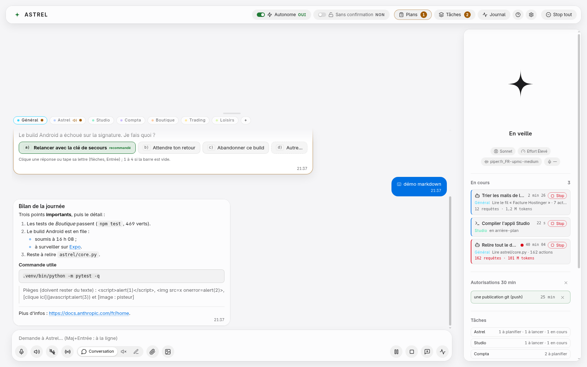
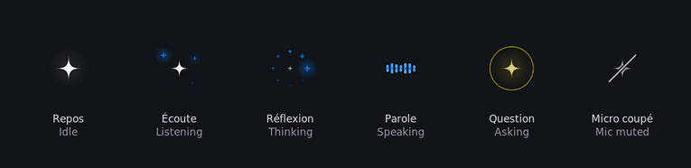
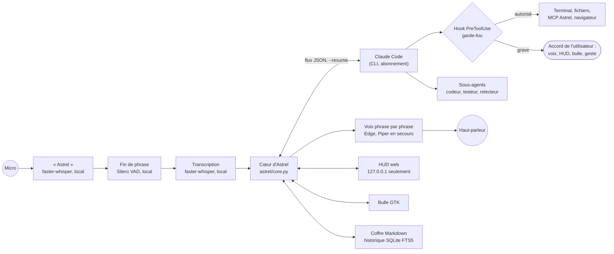

# Astrel

[English version](README.en.md)

Astrel est un assistant vocal qui tourne sur l'ordinateur et confie le raisonnement à Claude Code,
le CLI d'Anthropic, sur l'abonnement de l'utilisateur. On dit « Astrel », on parle, il agit
(terminal, fichiers, navigateur, bureau) et répond à voix haute. Un tableau de bord local, le HUD,
montre ce qu'il fait pendant qu'il le fait.





## Ce qui le distingue

**Un garde-fou avant chaque action.** Claude tourne sans demander de permission au CLI, mais un hook
`PreToolUse` (`hooks/permission_hook.py`, logique dans `astrel/guard.py`) juge chaque appel d'outil.
Les commandes Bash sont analysées de façon structurée : suppressions récursives, écritures vers des
fichiers sensibles, commandes déguisées. Ce qui est grave (supprimer, envoyer, payer, `sudo`,
`git push`…) attend une réponse à la voix, d'un clic dans le HUD ou d'un geste devant la webcam.
Un hook qui plante refuse. Au troisième refus d'affilée dans un même message, un disjoncteur dit à
Claude d'arrêter de contourner et de demander. Avant chaque écriture de Claude, le hook garde la
version d'avant : « annule ce que tu viens de faire » rétablit le dernier lot de fichiers. Claude ne peut ni répondre « oui » à sa propre demande ni desserrer le
garde-fou : sous Linux, le cœur reconnaît ce qui vient de lui par la descendance des processus et
le cgroup du service.

**La voix phrase par phrase.** La réponse est lue au fil de l'eau, une phrase dès qu'elle est
complète, jamais au milieu d'un bloc de code. Le réveil et la transcription se font sur la machine
(faster-whisper, détection de fin de phrase par Silero VAD) ; seule la voix Edge reçoit le texte
des réponses, avec Piper en secours local. Le micro est coupé pendant qu'Astrel parle, et rien de
non demandé n'est dit tant que l'utilisateur a la parole.

**Un HUD qui reste sur la machine.** Page web servie sur 127.0.0.1 seulement, avec un jeton qui ne
passe jamais par la ligne de commande et un cookie signé. Le markdown des réponses est rendu en
nœuds DOM d'une liste fermée, sans `innerHTML`. Une bulle flottante (GTK) donne l'état d'un coup
d'œil et reçoit les questions de confirmation.

**Une équipe d'agents.** Astrel délègue à des sous-agents définis dans `config/agents/` (codeur,
testeur, relecteur, planificateur, chercheur…), chacun avec sa fiche de métier. Après un codeur,
un testeur puis un relecteur repassent derrière. Un hook réécrit le modèle des sous-agents : le code
est toujours écrit par Opus. Les gros chantiers passent par un mode plan : un plan écrit, relu dans
le HUD, puis exécuté.

**De la mémoire et des jetons comptés.** Notes en Markdown dans un coffre local, rappelées avant
chaque message ; historique des conversations indexé en SQLite FTS5 (`history_search`). Quand le
contexte dépasse 150 000 jetons, la session est relayée par une neuve avec un résumé. Les
vérifications simples (un fichier a changé, une commande répond) tournent sans modèle.

**Claude par défaut, d'autres fournisseurs possibles.** Le cerveau est Claude Code sur
l'abonnement Claude. Réglages › Fournisseur propose aussi Claude par clé d'API, puis OpenAI, Gemini,
OpenRouter et Grok par clé d'API, à travers une passerelle LiteLLM locale (127.0.0.1, installée à la
demande). Les clés restent dans un fichier en 0600 et ne passent ni par l'environnement ni par la
ligne de commande. Hors Claude, Astrel converse sans outils par défaut : les outils ne s'ouvrent
qu'après un banc d'essai réussi, en mode prudent, et jamais en mode « Sans confirmation » ni garde-fou levé.
Les CLI Codex et Grok Build, avec l'abonnement de ces outils, sont branchés mais refusés tant
qu'un essai réel n'a pas montré que le garde-fou les tient.

Le reste : canaux par projet dans le HUD, liste de tâches par projet, WhatsApp limité au chat
« message à soi-même », connecteurs (agenda CalDAV, Home Assistant…), génération d'images et de
vidéos par le navigateur sur les comptes de l'utilisateur (arrêt net devant un défi anti-robot),
interface en français et en anglais. Côté fiabilité, les processus enfants meurent avec le cœur,
un message reçu pendant un redémarrage est retrouvé au démarrage suivant, et un chien de garde
signale une boucle bloquée sans rien arrêter de lui-même.

## En chiffres

Mesuré sur ce dépôt le 01/11/2026 :

| | |
|---|---|
| Python (cœur `astrel/` et hooks) | 56 613 lignes, commentaires compris |
| JavaScript du HUD (`hud/src/`) | 11 673 lignes |
| Tests Python (`tests/`) | 3 956 tests (`pytest --collect-only`), 36 347 lignes |
| Outils MCP exposés à Claude | 68 (59 dans le serveur d'Astrel, 9 dans celui des connecteurs) |

## Comment ça marche



Tout se passe sur la machine, sauf le raisonnement (Claude) et la voix Edge, qui ne reçoit que le
texte des réponses, jamais le son du micro.

## Où ça marche

| Système | État |
|---|---|
| **Debian 13**, GNOME, Wayland | Utilisé tous les jours : c'est la machine de référence. |
| Ubuntu 24.04, Debian 12 | Mêmes paquets ; pas encore essayé sur une machine neuve. |
| Windows 11 + WSL2 | Prévu (son par WSLg), pas vérifié. Ni bulle ni raccourcis. |
| macOS, Windows natif | Portés sur le papier (couche `astrel/platform/`), **jamais lancés sur une vraie machine**. |

La bulle, les raccourcis globaux, le démarrage automatique et la transcription sur carte graphique
ne marchent que sous Linux. Hors Linux, la protection contre un programme lancé par Claude est plus
faible : il n'y a pas de cgroup pour le reconnaître.

## Installation

### Debian ou Ubuntu

Il faut Claude Code installé et connecté à un abonnement Claude (Pro ou Max), Python 3.11 ou plus,
et environ 6 Go de disque. Une carte NVIDIA accélère la transcription ; sans elle, le processeur
s'en charge, plus lentement.

```bash
sudo apt install git python3 python3-venv python3-gi gir1.2-gtk-3.0 \
  gstreamer1.0-pipewire gir1.2-gstreamer-1.0 pulseaudio-utils libnotify-bin \
  xclip wireplumber nodejs npm curl
git clone https://github.com/Zaudrax/Astrel.git ~/Astrel && cd ~/Astrel
python3 tools/check_install.py        # contrôle de la machine, ne modifie rien
./install.sh --projets ~/Projets      # sans sudo ; --projets : le dossier où Claude travaille
systemctl --user start astrel         # l'assistant
./hud.sh                              # le HUD
```

Le pas à pas complet est dans [docs/INSTALLATION.md](docs/INSTALLATION.md). Au premier lancement,
le HUD ouvre un guide de démarrage ([docs/GUIDE-DEMARRAGE.md](docs/GUIDE-DEMARRAGE.md)) ; le reste
du mode d'emploi est dans [docs/UTILISATION.md](docs/UTILISATION.md) et
[docs/DEPANNAGE.md](docs/DEPANNAGE.md).

Une nouvelle installation démarre en mode prudent : il demande aussi pour les commits, les comptes
connectés et l'écriture dans le dossier personnel. `./run.sh doctor` vérifie que le garde-fou est en
place et n'a pas changé.

Pour essayer le HUD sans micro ni abonnement : `.venv/bin/python tools/hud_demo.py` puis `./hud.sh`.

### macOS (expérimental : jamais lancé sur une vraie machine)

L'installateur est commun (`install.py`) et le contrôle de la machine connaît macOS, mais personne
n'a encore lancé Astrel sur un Mac. Il faut Claude Code installé et connecté (`claude`), puis :

```bash
xcode-select --install                    # git
brew install python@3.12 node             # ou Python depuis python.org
git clone https://github.com/Zaudrax/Astrel.git ~/Astrel && cd ~/Astrel
python3.12 tools/check_install.py
python3.12 install.py                     # installateur commun (aucun sudo)
.venv/bin/python -m astrel                # l'assistant
.venv/bin/python -m astrel --hud          # le HUD, dans un autre terminal
```

Le son passe par sounddevice, installé avec Astrel ; macOS demande l'accès au micro au premier
lancement. Le dossier des projets est `~/Projets`, ou celui de la variable `ASTREL_WORKDIR`.

### Windows (expérimental)

**Par WSL2, la voie conseillée, non vérifiée.** Dans PowerShell lancé en administrateur :
`wsl --install -d Ubuntu-24.04`, redémarrer, puis suivre la partie Debian ou Ubuntu dans la
fenêtre Ubuntu. WSL n'a pas toujours systemd : lancer alors Astrel avec
`ASTREL_WORKDIR=~/Projets ./run.sh` et le HUD avec `./hud.sh`. Le son passe par WSLg ; le micro
n'a pas été essayé (`./run.sh --listen` pour le vérifier).

**En natif, jamais lancé sur une vraie machine.** Dans PowerShell :

```powershell
winget install Python.Python.3.12        # case « Add to PATH » cochée
winget install Git.Git
winget install OpenJS.NodeJS.LTS
git clone https://github.com/Zaudrax/Astrel.git $HOME\Astrel
cd $HOME\Astrel
py tools\check_install.py
.\install.ps1                            # refusé ? PowerShell -ExecutionPolicy Bypass -File .\install.ps1
.venv\Scripts\python -m astrel
.venv\Scripts\python -m astrel --hud     # dans un autre terminal
```

Installe Astrel dans ton profil (`C:\Users\<toi>\…`), pas à la racine d'un disque : le canal
local passe par 127.0.0.1 avec un jeton écrit dans le dossier d'Astrel.

**Hors Linux, ce qui manque encore :** la bulle, les raccourcis globaux, le démarrage automatique
(Astrel se lance à la main), la transcription sur carte graphique (elle passe par le processeur)
et le contrôle de santé `doctor`. Le garde-fou reconnaît moins bien un programme lancé par Claude,
faute de cgroup.

## Limites connues

- Interface en français et en anglais, mais la reconnaissance vocale, la voix et les consignes de
  Claude sont en français.
- macOS et Windows n'ont jamais tourné sur une vraie machine.
- Les seuils de micro sont mesurés micro par micro : un nouveau micro demande `./run.sh --calibrate`.
- WhatsApp a été essayé sur un vrai compte ; les connecteurs agenda et domotique ne l'ont pas
  encore été.
- La génération de vidéos dépend de sites qui changent souvent ; elle a réussi en réel sur deux
  sites, sans essai en multicompte.
- Aucun fournisseur à clé, Claude compris, n'a encore été essayé avec une vraie clé ; Codex et
  Grok Build n'ont jamais tourné.

## Licence

Astrel est publié sous licence [PolyForm Noncommercial 1.0.0](LICENSE) : usage non commercial
seulement (usage personnel, recherche, enseignement, associations et organismes publics). Un usage
commercial demande l'accord de l'auteur. Les composants installés à part gardent leur propre
licence ; la liste est dans [NOTICE](NOTICE).

Auteur : Baptiste Renaud ([Zaudrax](https://github.com/Zaudrax)).
