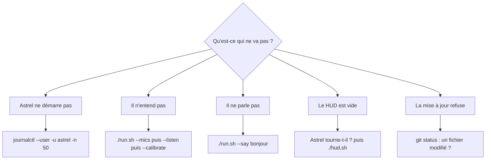

# Dépannage

Toujours commencer par :

```bash
python3 tools/check_install.py     # la machine (lecture seule)
./run.sh --doctor                  # Astrel installé : garde-fou, MCP, droits des fichiers
```

Pour demander de l'aide, colle le **rapport** affiché en bas de
`check_install.py` (sans e-mail, nom d'utilisateur ni chemin personnel) et les
dernières lignes du journal : `journalctl --user -u astrel -n 50`.



## Astrel ne démarre pas

| Ce que dit le journal | Quoi faire |
|---|---|
| `claude: not found` ou « Claude Code introuvable » | Claude Code n'est pas dans le PATH du service : relance `./install.sh` (il note où est `claude`). |
| « non connecté », `authentication` | `claude` dans un terminal, connecte-toi, puis `systemctl --user restart astrel`. |
| `No module named …` | dépendances incomplètes : `./install.sh`. |
| `Library libcublas.so.12 is not found` | bibliothèques CUDA introuvables : `./install.sh` les réinstalle ; sinon, transcription sur le processeur avec `ASTREL_STT_DEVICE=cpu` et `ASTREL_STT_COMPUTE=int8`. |
| rien du tout | `systemctl --user status astrel` ; sans systemd (WSL) : `.venv/bin/python -m astrel` dans un terminal. |

## Il n'entend pas son nom (« Astrel », ou l'ancien mot d'éveil)

Une notice « Je n'entends plus le mot d'éveil » dit que la reconnaissance
vocale locale ne se charge pas ET que l'ancien mot est coupé : réveil par
Ctrl+Alt+J ou double clic sur la bulle, ou rallume « Accepter aussi l'ancien mot
d'éveil » (Réglages › Voix, audio et langue). Dis le nom SEUL, puis ta question
après le carillon. Si la reconnaissance écrit le nom autrement (« astral »),
ajoute cette forme à « Variantes du nom qui réveillent ». Ensuite :

1. `./run.sh --mics` : ton micro est-il dans la liste ? Sinon, vérifie les
   réglages de son du système (micro par défaut, pas coupé).
2. `./run.sh --listen` : parle ; ta phrase doit s'afficher. Sinon le micro
   n'arrive pas jusqu'à Astrel.
3. `./run.sh --calibrate` : 4 secondes de silence puis 10 secondes de voix ;
   Astrel mesure TON micro et retient ses réglages (`config/mic_profiles.json`).
4. `./run.sh --diag` : vumètre, détection de la voix et mot de réveil en
   direct. Dis le nom : une ligne « ÉVEIL « … » (texte) » doit s'afficher, avec la
   forme reconnue.
   La colonne « alias » est le score de l'ancien mot d'éveil : il doit
   dépasser le seuil (0,4 par défaut) quand tu le dis.
   `./run.sh --diag --wav fichier.wav` rejoue un enregistrement (mono, 16 bits,
   16 kHz) au lieu du micro.
5. Le bouton micro du HUD est-il coupé ? Un micro coupé le reste après une
   relance : rallume-le dans le HUD.

WSL2 : le micro passe par WSLg (Windows 11). Si `--mics` ne montre rien,
vérifie que Windows autorise l'accès au micro (Paramètres → Confidentialité →
Microphone).

## Il entend mais ne parle pas

- `./run.sh --say "bonjour"` : tu dois entendre la voix.
- `./run.sh --chimes` : tu dois entendre les carillons.
- Rien : la sortie son par défaut du système est-elle la bonne ? Le bouton ⏸
  (pause de la voix) ou « Silencieux » du HUD est-il actif ?
- La voix Edge demande Internet ; sans réseau, Astrel passe sur la voix locale
  (Piper) et l'écrit dans le HUD.

## Le HUD est vide ou ne s'ouvre pas

- Astrel doit tourner AVANT `./hud.sh`.
- La page refuse la connexion : ferme la fenêtre du HUD et relance `./hud.sh`
  (il obtient un accès neuf à chaque ouverture).
- Sans Chrome ni Chromium, le HUD s'ouvre dans ton navigateur par défaut ;
  l'orbe 2D fonctionne aussi bien dans ce navigateur.

## Il demande toujours la permission

C'est le **mode prudent**, celui d'une nouvelle installation. Pour qu'il ne
demande plus que l'irréversible : bouton ⚡/🛡 du HUD (mode autonome). Claude ne
peut pas changer ce mode lui-même.

## La mise à jour refuse

- « Des fichiers d'Astrel ont été modifiés » : tu (ou Claude) as changé un
  fichier suivi. `git status` le montre ; `git stash` le met de côté,
  `git checkout -- FICHIER` l'annule. Relance `./update.sh`.
- « copie divergente » : `git log --oneline -3` et demande de l'aide avec ce
  qu'il affiche.
- Réseau ou accès refusé : ton accès au dépôt (compte invité ou clé) est-il
  toujours valable ?

## Le contrôle de santé dit « empreinte du garde-fou » en ALERTE

Les fichiers qui décident de laisser passer une action ont changé depuis la
dernière validation. Après une mise à jour normale, `./update.sh` la refait
seul. Si tu n'as rien mis à jour : quelqu'un (ou Claude) a modifié le garde-fou ;
`git status` le montre. Une fois sûr de toi : `./run.sh --doctor --accept`,
depuis TON terminal (refusé à Claude).
