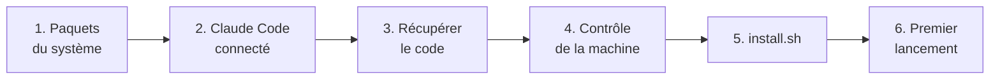

# Installer Astrel, pas à pas

Compte 30 à 45 minutes, téléchargements compris (~2 Go pour les dépendances,
~550 Mo de modèles). Aucune étape n'a besoin des droits administrateur, sauf
l'installation des paquets du système (`sudo apt …`).

État des systèmes : voir le tableau « Où ça marche » du [README](../README.md).
Ce guide décrit **Debian / Ubuntu** (natif ou dans WSL2), la seule voie
utilisable aujourd'hui.



---

## 0. Windows : préparer WSL2 (sinon, passe à l'étape 1)

1. Clic droit sur le menu Démarrer → **Terminal (administrateur)**.
2. Tape :
   ```powershell
   wsl --install -d Ubuntu-24.04
   ```
3. Redémarre quand Windows le demande. Au retour, la fenêtre « Ubuntu » s'ouvre
   et demande un nom d'utilisateur et un mot de passe : choisis-les (le mot de
   passe ne s'affiche pas quand tu le tapes, c'est normal).
4. Toutes les commandes suivantes se tapent **dans cette fenêtre Ubuntu**.
5. Vérifie que systemd tourne : `systemctl --user status` doit répondre. Sinon :
   `printf '[boot]\nsystemd=true\n' | sudo tee /etc/wsl.conf`, puis
   `wsl --shutdown` dans PowerShell, et rouvre Ubuntu.
6. Installe Google Chrome dans Ubuntu (le HUD s'ouvre dans sa fenêtre) :
   ```bash
   wget https://dl.google.com/linux/direct/google-chrome-stable_current_amd64.deb
   sudo apt install ./google-chrome-stable_current_amd64.deb
   ```
7. Clone Astrel dans le dossier Linux (`~/Astrel`), jamais sous `/mnt/c/…`.

Windows 11 fournit le son et les fenêtres à WSL (WSLg). Le micro dans WSL n'a
pas encore été essayé avec Astrel : l'étape 6 dit comment le vérifier.

---

## 1. Les paquets du système

```bash
sudo apt update
sudo apt install git python3 python3-venv python3-gi gir1.2-gtk-3.0 \
  gstreamer1.0-pipewire gir1.2-gstreamer-1.0 gstreamer1.0-plugins-good \
  pulseaudio-utils libnotify-bin xclip wireplumber libgtk-3-bin \
  nodejs npm curl poppler-utils
```

| Paquet | Sert à |
|---|---|
| `python3`, `python3-venv` | faire tourner Astrel (Python 3.11 ou plus) |
| `python3-gi`, `gir1.2-gtk-3.0` | la bulle flottante |
| `gstreamer1.0-pipewire`, `gir1.2-gstreamer-1.0` | la capture d'écran (GNOME) |
| `pulseaudio-utils` | le micro et le haut-parleur (`parecord`, `paplay`) |
| `libnotify-bin`, `xclip`, `wireplumber`, `libgtk-3-bin` | notifications, presse-papiers, volume, ouvrir une application |
| `nodejs`, `npm` | le navigateur piloté par Claude (facultatif) |
| `poppler-utils` | l'aperçu des PDF dans le fil du HUD (facultatif) |

Le HUD s'ouvre de préférence dans **Google Chrome** ou **Chromium** (fenêtre
d'application) ; sinon dans ton navigateur par défaut.

## 2. Claude Code, connecté à TON compte

Installe Claude Code en suivant la page officielle :
<https://docs.claude.com/claude-code>. Puis, une fois :

```bash
claude
```

Une page de connexion s'ouvre : connecte-toi avec ton compte Claude (abonnement
Pro ou Max). Quitte ensuite Claude Code avec `/exit`. Vérification :

```bash
claude auth status --text
```

doit dire que tu es connecté.

## 3. Récupérer le code

Le dépôt est **privé**. Selon l'accès qu'on t'a donné :

<details open>
<summary><b>Tu as un compte GitHub invité sur le dépôt</b></summary>

```bash
sudo apt install gh          # l'outil GitHub (ou https://cli.github.com)
gh auth login                # connecte ton compte GitHub
gh repo clone <propriétaire>/<dépôt> ~/Astrel
```

</details>

<details>
<summary><b>On t'a envoyé une clé d'accès (fichier de clé de déploiement)</b></summary>

```bash
mkdir -p ~/.ssh && chmod 700 ~/.ssh
cp CHEMIN/DU/FICHIER/astrel_deploy ~/.ssh/astrel_deploy
chmod 600 ~/.ssh/astrel_deploy
cat >> ~/.ssh/config <<'EOF'
Host github-astrel
  HostName github.com
  User git
  IdentityFile ~/.ssh/astrel_deploy
  IdentitiesOnly yes
EOF
git clone github-astrel:<propriétaire>/<dépôt>.git ~/Astrel
```

Cette clé ne permet que de LIRE : tu reçois les mises à jour, tu ne peux rien
envoyer.

</details>

Puis :

```bash
cd ~/Astrel
```

## 4. Contrôle de la machine

```bash
python3 tools/check_install.py
```

Il ne modifie rien. Chaque ligne commence par :

| Mot | Sens |
|---|---|
| `OK` | prêt |
| `MANQUE` | **bloquant** : l'installation échouera ; la flèche → dit quoi faire |
| `ALERTE` | Astrel marchera, sans cette fonction (ex. pas de capture d'écran) |
| `INFO` | pour information |

Corrige les `MANQUE`, relance le contrôle, puis continue. En bas s'affiche un
**rapport à coller** : c'est lui qu'on envoie pour demander de l'aide.

## 5. Installer

```bash
./install.sh --projets ~/Projets
```

`--projets` : le dossier où Claude travaillera (tes projets). Crée-le avant
s'il n'existe pas (`mkdir -p ~/Projets`). Ce que fait l'installation, dans
l'ordre :

1. le même contrôle qu'à l'étape 4 (elle s'arrête s'il manque quelque chose) ;
2. l'environnement Python dans `.venv` et les dépendances (le plus long) ;
3. tes réglages, copiés depuis les exemples `config/*.example.json` ;
4. les modèles locaux (voix de secours, gestes, visage) ;
5. le navigateur piloté (si Node.js est là) ;
6. le démarrage automatique (service `systemd` utilisateur, bulle, raccourcis
   GNOME) ;
7. l'empreinte du garde-fou (`--doctor --accept`).

Ta première installation démarre en **mode prudent** (voir la sécurité dans le
README). Options : `./install.sh --help`.

## 6. Premier lancement

```bash
systemctl --user start astrel
./hud.sh
```

- Le HUD s'ouvre : l'orbe apparaît, et le **guide de démarrage** avec lui. Suis ses étapes : compte Claude, micro, voix, langue,
  dossier des projets, WhatsApp (facultatif), démarrage automatique. Chacune a
  son bouton « Tester » ou son réglage sur place. Le même texte est dans
  [GUIDE-DEMARRAGE.md](GUIDE-DEMARRAGE.md).
- Dis **« Astrel »**, attends le carillon, demande « quelle heure est-il ? ».
  L'ancien mot d'éveil marche aussi pendant la transition (réglage
  « Accepter aussi l'ancien mot d'éveil », sur Oui par défaut).

Si rien ne se passe :

```bash
./run.sh --mics          # le micro est-il vu ?
./run.sh --listen        # parle : ta phrase doit s'afficher
./run.sh --calibrate     # règle Astrel sur ton micro (4 s de silence, 10 s de voix)
journalctl --user -u astrel -f     # le journal en direct
```

Sans systemd (certains WSL) : lance `ASTREL_WORKDIR=~/Projets ./run.sh` dans
un terminal et laisse-le ouvert (`ASTREL_WORKDIR` : ton dossier de projets).

Mode clavier, sans micro : `./run.sh --text`.

## Et après

- Relier WhatsApp : HUD › Réglages › WhatsApp › « Relier avec un QR » (voir le
  guide de démarrage).
- Mettre à jour : `./update.sh` (voir le README).
- Ajouter tes projets comme onglets du HUD : `config/channels.json`
  ([UTILISATION.md](UTILISATION.md), « Canaux »).
- Brancher ton agenda, les trains, la traduction : [CONNECTEURS.md](CONNECTEURS.md).
- Un souci : [DEPANNAGE.md](DEPANNAGE.md).
